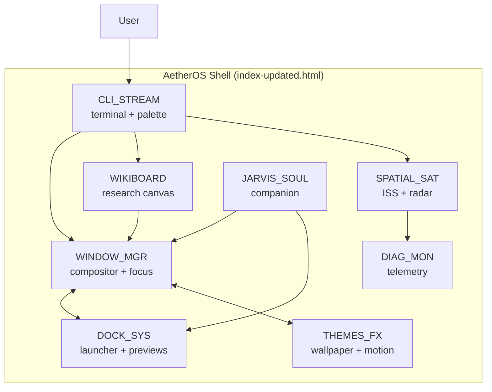
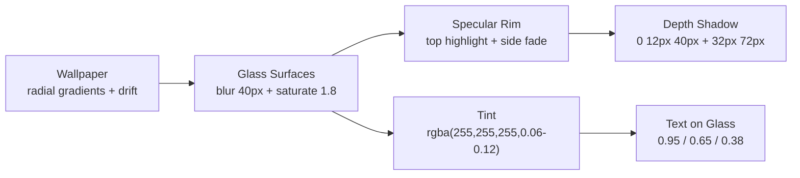
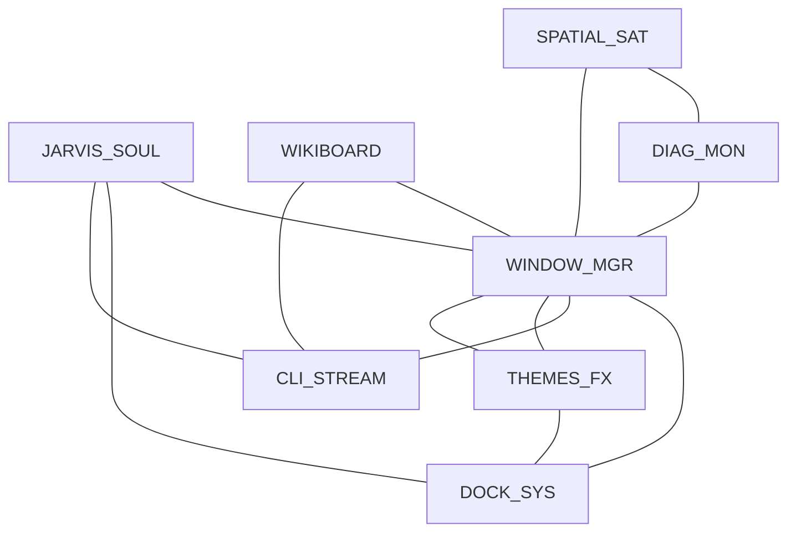
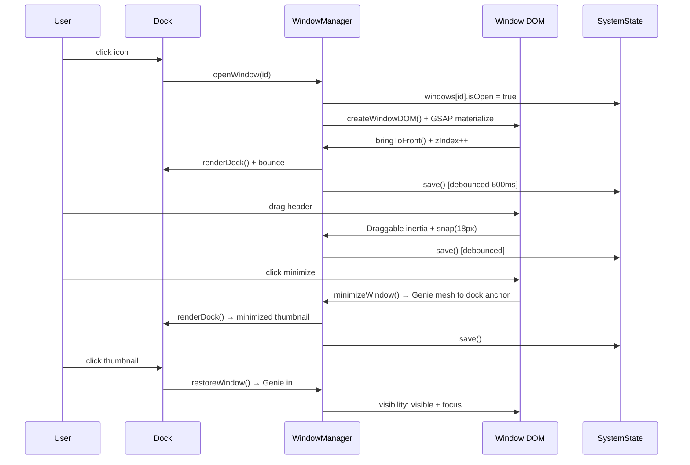
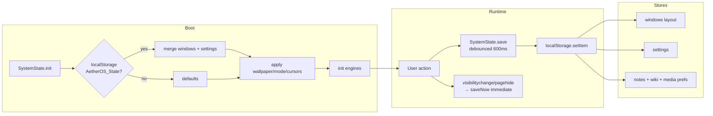
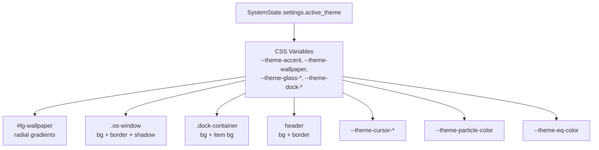
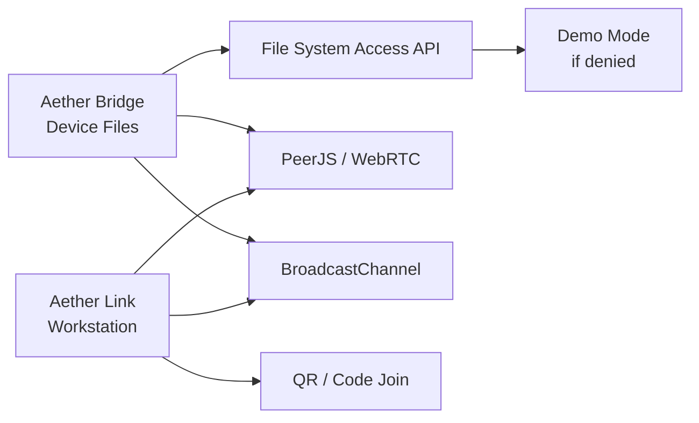
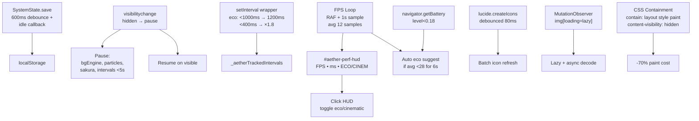

# AetherOS — Browser-Native Operating Environment

> **Zero-build, client-side, modular desktop shell.**  
> A desktop shell that happens to live inside the browser: multi-window, themeable, noisy in the right places, and packed with realtime modules, local memory, and visual polish.

**Live demo:** https://meyashverma.github.io/AetherOS-Prod/  
**Repo:** https://github.com/MeYashverma/AetherOS-Prod  
**Build:** Modular vanilla architecture (`index.html` + `styles/` + `src/`) — no backend, no build step, no framework.  
**Stack:** HTML · CSS · Tailwind · GSAP · Three.js · Lucide · WebLLM · IndexedDB · WebRTC · Web APIs

---

## Table of Contents
- [What this is](#what-this-is)
- [Visual Language](#visual-language)
- [Architecture](#architecture)
- [Window Manager & Dock](#window-manager--dock)
- [State & Persistence](#state--persistence)
- [Theme Engine](#theme-engine)
- [Module Inventory](#module-inventory)
- [Core Systems](#core-systems)
- [API & Service Inventory](#api--service-inventory)
- [Fluency & Performance Engine](#fluency--performance-engine)
- [Keyboard, Commands & Shortcuts](#keyboard-commands--shortcuts)
- [Settings Catalog](#settings-catalog)
- [Browser Features Used](#browser-features-used)
- [Quick Start](#quick-start)
- [Optimization Report](#optimization-report)
- [Roadmap & Feature Suggestions](#roadmap--feature-suggestions)
- [Credits](#credits)

---

## What this is

AetherOS runs as a full **browser-native desktop shell** organized into modular stylesheets, engines, services, templates, and feature modules with zero build step required. It ships its own:

- Window manager (drag, resize, snap, focus, z-index, Genie minimize)
- Dock with magnification, running indicators, minimized thumbnails, live previews
- Command palette (`Ctrl/Cmd+K`) and terminal (`Data Stream`)
- Settings, local persistence, media, tracking, research, and experimental modules
- Companion system (JARVIS-style) with voice, eyes, emotion GIFs

Not a landing page. Not a dashboard. A **browser-native workstation**.



---

## Visual Language

Dark, premium, desktop-first. Every surface is **liquid glass**: translucent, blurred, saturated, with specular rims.

- **Dock:** macOS-style pill, glass, magnification (JS spring), running dots, minimized live thumbnails
- **Windows:** rounded 14px, custom traffic lights, drag with GSAP Draggable inertia, Genie minimize to dock anchor
- **Glass:** `backdrop-filter: blur(40-48px) saturate(1.8)` + inner gradients + top hairline rim
- **Wallpaper:** vivid multi-radial gradient (indigo · fuchsia · teal · blue) with `hue-rotate` drift + grain texture
- **Cursors:** 12 themes (aether, minimal, neon, comet, cursorly, ripple, sparkle, binary, crosshair, gold, void, nyan) + Oneko cat (40+ variants) + ball physics
- **Ambient:** Three.js particles (300 → throttled), `aether-particles` canvas (40-70), sakura petals, scanlines, particle overlays
- **Modes:** `eco` (throttled, reduced blur) vs `cinematic` (full glass, 40fps)



---

## Architecture

```text
AetherOS-Prod/
├── index.html                                  # Lightweight desktop shell entrypoint (~567 lines)
├── styles/
│   ├── core.css                                # Design tokens, window chrome, dock previews & lyrics themes
│   ├── modules-and-overlays.css                # Module layouts, companion sidebar, radio deck, Finder & menus
│   └── liquid-glass.css                        # Liquid Glass surface system, wallpaper, dock pill & responsive rules
└── src/
    ├── config/
    │   └── tailwind.config.js                  # Tailwind runtime color & shadow configuration
    ├── core/
    │   ├── primitives.js                       # SignalCore, ModuleLifecycle, Notifications, RenderScheduler & extendOS
    │   └── system-state.js                     # SystemState settings, 35-window registry & localStorage persistence
    ├── ui/
    │   ├── settings-tabs.js                    # System Settings tab templates
    │   ├── shell-interactions.js               # NotificationCenter, delegated cursor hover & outside-click/Escape dismissal
    │   └── templates/
    │       ├── system-templates.js             # System, diagnostics, terminal & inspector window templates + SysmonViews
    │       ├── media-space-templates.js        # Media, radio, anime/manga, games, weather & space window templates
    │       └── network-workspace-templates.js  # Browser, feeds, radar, optics, productivity & P2P window templates
    ├── engines/
    │   ├── ambient-engines.js                  # Three.js BackgroundEngine, Sakura petals & OnekoBallEngine
    │   ├── cursor-engine.js                    # 12 cursor themes, Nyan overlay & Oneko companion cat physics
    │   ├── window-manager.js                   # Window compositor, Genie mesh minimize, dock spring physics & previews
    │   ├── command-palette.js                  # CommandPalette spotlight launcher (Ctrl/Cmd+K)
    │   └── wikiboard-engine.js                 # WikiBoard infinite research canvas & graph minimap
    ├── services/
    │   ├── aether-bridge.js                    # AetherBridge WebRTC P2P device sync & file transfer service
    │   ├── aether-link.js                      # AetherLink P2P chat, voice walkie-talkie, screen share & mini-apps
    │   └── ai-assistant.js                     # Local AI Assistant, deterministic OS command parser & lazy WebLLM
    ├── modules/
    │   ├── shell-and-theme.js                  # Topbar telemetry, Finder, dock pinning, themes, wallpaper & WakeLock
    │   ├── voice-and-companion.js              # Speech Synthesis TTS, Emo OLED face engine & Companion chat brain
    │   ├── lastfm-analytics.js                 # Last.fm scrobble metrics, listening clock, heatmap & treemaps
    │   ├── diagnostics-and-tasks.js            # Data Stream terminal, Sysmon, Cloudflare Speed Test & Task Manager
    │   ├── space-and-weather.js                # Weather Station, NASA Explorer, ISS 3D Three.js tracker & Game Vault
    │   ├── media-and-lyrics.js                 # Media Console, Audio Engine & BetterLyrics sync
    │   ├── radio-and-youtube.js                # Global Radio Browser v3, station favorites & YouTube Ambient
    │   ├── anime-and-tv.js                     # Anime & Manga explorer, YTCH Retro TV & Memetic Intelligence
    │   ├── web-and-feeds.js                    # Browser engine, Floor796, WPlace, Signal Feed & Discord Lanyard/Webhook
    │   ├── radar-and-optics.js                 # 2D ADS-B Flight Radar, Crypto Market Matrix & AI Vision Surveillance
    │   └── workspace-apps.js                   # Entity Scanner, File Manager, Encrypted Notes, About & WikiBoard hooks
    └── boot/
        └── main.js                             # Runtime error collector, boot materialization & idle schedulers
```

**Internal architecture view (in-app):**



---

## Window Manager & Dock

### Lifecycle



### Features
- Absolute-positioned workspace, clamped to viewport
- **Dragging:** GSAP Draggable + inertia, bounds, snap to edges (18px threshold)
- **Resizing:** corner handle, min sizes, aspect hints
- **Focus:** z-index stack, `focused` class, header highlight
- **Minimize/Restore:** Genie mesh — window sliced into strips, curved to dock anchor via `transform` + `clipPath`, no layout thrash
- **Dock:** Finder icon + pinned + running + minimized; separators; macOS magnification (spring `cubic-bezier(0.34,1.56,0.64,1)`); tooltips; live previews (HTML snapshot scaled via `transform: scale()`)
- **Finder overlay:** 740px glass panel, search filter, pinned toggle, sections
- **Previews:** on hover, cloned window content scaled 0.22, cached
- **Thumbnails:** minimized windows render as 92×58 pill with header dots, live content scaled
- **Context menu:** right-click dock → Pin / Unpin / Close

---

## State & Persistence



**Details:**
- Key: `AetherOS_State` (JSON)
- **Debounced save (Fluency):** `SystemState.save()` → 600ms debounce via `setTimeout`, flush on `visibilitychange`/`pagehide` via `saveNow()`. Prevents hundreds of writes during drag/resize.
- **Migrations:** on `load()`, ensures missing windows/settings keys get defaults (e.g., `wallpaper_mode='gif'`, `cursor_oneko='off'`, etc.)
- **IndexedDB:** `AetherOS_LocalAI` for WebLLM models, messages, memories; `AetherOS_WikiBoard` (via localStorage) for canvas cards; `AetherOS_WikiBoard` cards stored as JSON
- **Encryption:** Notes module uses password-derived lock (Web Crypto) + local buffer
- **Reset:** `SystemState.reset()` clears storage, reloads defaults

---

## Theme Engine

12 themes: `midnight`, `aurora`, `synthwave`, `ember`, `ice`, `rose`, `solar`, `hacker`, `neonvoid`, `sakura`, `carbon`, `ocean`. Each changes accent, wallpaper, glass tint, particle color, cursor glow.



**Variables (excerpt):**
```css
--theme-accent: #ffffff;
--theme-wallpaper: radial-gradient(...), linear-gradient(135deg, #0d0f2b ...);
--theme-glass-bg: rgba(255,255,255,0.07);
--theme-dock-bg: rgba(255,255,255,0.08);
--theme-window-shadow: 0 2px 6px ..., 0 12px 40px ..., inset 0 1px 0 rgba(255,255,255,0.42);
```

Apply via `os.applyTheme(name)` → sets `document.documentElement` variables + saves.

---

## Module Inventory

| # | ID | Title | Icon | Category | Description |
|---|----|-------|------|----------|-------------|
| 1 | `settings` | System Config | `sliders` | shell | Wallpaper, gif, quotes, speech, cursor, performance, API keys |
| 2 | `terminal` | Data Stream | `terminal` | shell | CLI, command stream, wiki/matrix commands |
| 3 | `media` | Media Console | `radio` | media | Last.fm now-playing, visualizer, lyrics (LRCLib → lyrics.ovh), GIF mood |
| 4 | `radiobrowser` | Global Radio Network | `radio-tower` | media | Radio Browser API, vinyl/tonearm UI, visualizer, GIF layer |
| 5 | `sysmon` | System Diagnostics | `cpu` | telemetry | CPU/ram/net graphs, storage, perf mode, raw stats |
| 6 | `nosleep` | NoSleep Screen Lock | `sun` | shell | Wake Lock API + media keep-awake fallback |
| 7 | `presence` | Uplink Presence | `user` | social | Lanyard presence, Discord/GitHub/RSS |
| 8 | `feed` | Global Signal Feed | `rss` | social | Hacker News, Reddit, RSS |
| 9 | `browser` | Web Proxy Interface | `globe` | research | Proxy + helper transport |
| 10 | `wplace` | Wplace Live Canvas | `paintbrush` | canvas | Iframe live canvas, 180MB IndexedDB fallback |
| 11 | `floor796` | Floor796 Explorer | `building-2` | canvas | Deep zoom explorer |
| 12 | `globe` | Tactical Airspace Radar | `plane` | tracking | CesiumJS globe + Three, OpenSky flights |
| 13 | `market` | Market Matrix | `trending-up` | telemetry | Market data |
| 14 | `surveillance` | Optics Node | `camera` | media | Camera / sensor |
| 15 | `notes` | Memory Scratchpad | `lock` | knowledge | Encrypted notes |
| 16 | `memes` | Memetic Intelligence | `smile` | media | OtakuGIFs/Nekos/Giphy/Tenor |
| 17 | `ytchtv` | Retro TV (YTCH.TV) | `tv` | media | Retro streams |
| 18 | `entityscanner` | Universal Entity Scanner | `scan` | research | Dragon Ball + entity browsing |
| 19 | `filemanager` | Living Archive | `folder-tree` | knowledge | Folders, breadcrumbs, Wiki live folders, previews |
| 20 | `wikiboard` | WikiBoard Research | `network` | knowledge | Infinite canvas, cards, connections, minimap |
| 21 | `weather` | Weather Station | `cloud-rain` | tracking | Open-Meteo + geo |
| 22 | `nasa` | NASA Deep Space | `telescope` | tracking | APOD, EPIC, Mars |
| 23 | `taskmanager` | Task Manager | `list-x` | shell | Running/minimized, kill |
| 24 | `games` | Game Vault | `gamepad-2` | media | Embedded games |
| 25 | `iss` | ISS Tracker | `satellite` | tracking | Where The ISS At + Cesium/Three |
| 26 | `youtubeambient` | YouTube Ambient | `youtube` | media | Piped/Invidious ambient playback |
| 27 | `anime` | Anime Discovery | `sparkles` | research | Jikan/AniList/Kitsu |
| 28 | `manga` | Manga Launcher | `book-open` | research | MangaDex |
| 29 | `storage` | Storage Inspector | `database` | shell | localStorage/IDB usage |
| 30 | `errorconsole` | Error Console | `bug` | shell | Runtime capture |
| 31 | `apistatus` | API Status Board | `activity` | telemetry | Endpoint health |
| 32 | `packetviz` | Packet Visualizer | `network` | telemetry | Network viz |
| 33 | `about` | System Encyclopedia | `info` | docs | Docs, wiki, metrics, roadmap, credits |
| 34 | `aetherbridge` | Aether Bridge | `radio-tower` | pairing | Device file bridge (File System Access + PeerJS) |
| 35 | `aetherlink` | Aether Link | `link-2` | pairing | Workstation link (PeerJS + BroadcastChannel + QR) |

---

## Core Systems

### Desktop / Shell
- Absolute multi-window, z-index, focus ring, traffic lights
- Dock: finder, pinned, running, minimized, separators, magnification, tooltips, previews
- Command palette, finder overlay, context menus
- Task manager, storage inspector, error console, encyclopedia
- Persistence + session restore

### Research / Knowledge
- **WikiBoard:** infinite canvas (`#wb-viewport` + `#wb-canvas-layer` + SVG connections), pan/zoom (`will-change: transform`), double-click create, minimap, card types (wiki, text, image, youtube, pdf), resize, link expandable (`border-bottom: dashed`), export/import
- **FileManager:** tree, breadcrumbs, search, wiki fetch, quick look, recommendations
- **Notes:** textarea + password lock + Web Crypto

### Media
- **Media Console:** Last.fm (requires `api_lastfm` + `api_lastfm_user`), LRCLib → lyrics.ovh → no-lyrics, Deezer/iTunes fallback, GIF overlay (`#rb-gif-bg` blur 14px), vinyl, tonearm, visualizer (`#rb-visualizer-canvas`)
- **Stickers & Profiles:** Finder media library and lyric-chat picker for keyless [StickersAPI](https://stickerapi.sbs/docs) stickers, emotes, public Telegram sets, PFPs and banners. In WhatsApp-style lyric chat, the first eligible mood cue tries a StickersAPI sticker inside the lyric bubble; a visible source credit appears only after its image loads. Automatic reactions fall back to Discord, Sticker.ly and local media; the in-app connection test checks a sample image as well as search. [Details](docs/music-and-verci.md#stickersapi-automatic-media-and-app-wide-library).
- **Radio Browser:** topvote/trending, station search, play via `<audio>` + visualizer
- **YouTube Ambient:** Piped search + Invidious mirrors + proxy fallback, `youtubeambient` window
- **YTCH.TV:** retro TV iframe with mirror handling

### Tracking / Telemetry
- **Weather:** `ipwho.is` → `ipapi.co` → Open-Meteo forecast + geocoding, manual override
- **ISS:** `wheretheiss.at` every 10s + pos 500ms, Cesium/Three globe
- **Globe/Radar:** Cesium photorealistic, Three particles, OpenSky flights every 30s
- **PacketViz / SysMon:** canvas graphs, `performance.memory`, `navigator.*`
- **API Status:** fetch health of all endpoints

### Communication / Pairing


---

## API & Service Inventory

**Music/Lyrics:** Last.fm, LRCLib, lyrics.ovh, Deezer, iTunes Search  
**Presence/Social:** Lanyard, Discord CDN, GitHub API, RSS, Reddit, HN  
**Weather/Geo:** Open-Meteo, Open-Meteo Geocoding, ipwho.is, ipapi.co  
**Space/Tracking:** Where The ISS At, OpenSky, NASA (APOD/EPIC/Mars), Cesium, Three  
**Radio/Media/GIFs:** Radio Browser, StickersAPI, Discord public stickers, Sticker.ly, OtakuGIFs, Nekos, Giphy, Tenor, Klipy, YTCH.TV, Piped, Invidious, Rammerhead<br>
**Research:** Wikipedia/Wikimedia, MangaDex, Jikan, AniList, Kitsu, Dragon Ball API, Animechan, Quotable  
**Transport:** AllOrigins, Codetabs, CORS helpers, R.jina.ai, BroadcastChannel, PeerJS, File System Access, Wake Lock, Web Crypto

**Fallback chains (examples):**
- **Presence:** Lanyard WS → REST → offline
- **Weather:** ipwho.is → ipapi.co → Open-Meteo → cached → manual
- **Lyrics:** LRCLib synced → plain → lyrics.ovh → none
- **Video:** Piped search → alt instance → best match → proxy → Invidious
- **Keep-awake:** Wake Lock → media loop → external helper
- **Bridge:** File System Access → demo → PeerJS → BroadcastChannel → QR

---

## Fluency & Performance Engine

**New in `index-updated.html` — non-destructive patch preserving all visuals.**

### What it does



### CSS layer

```css
.os-window { contain: layout style paint; transform: translateZ(0); }
.os-window[style*="display: none"] { content-visibility: hidden; contain-intrinsic-size: 800px 600px; }
html.perf-eco .tactile-panel { backdrop-filter: none !important; }
#aether-particles { will-change: transform; }
```

- **Eco vs Cinematic:** `html.perf-eco` disables `backdrop-filter` on panels/windows, reduces particles opacity 0.38→0.18, slows EQ/sakura.
- **Low-end detection:** `navigator.hardwareConcurrency <=4 || deviceMemory <=4` → adds `aether-low-end`.
- **Reduced motion:** `prefers-reduced-motion` → disables particles/webgl, throttles intervals to 2s.

### JS layer

- **Debounced saves:** `SystemState.save` → 600ms, `saveNow` immediate on `visibilitychange`/`pagehide`.
- **Visibility pause:** `document.hidden` or `blur` → `window.__AETHER_PAUSED=true`, `bgEngine.isRendering=false`; resume on `focus`/`visible`.
- **Interval wrapper:** patches `window.setInterval` to scale delays in eco/reduced mode, skips <5s intervals while hidden, tracks in `_aetherTrackedIntervals`.
- **FPS HUD:** bottom-right, `Ctrl+Shift+P` toggle, shows `FPS • ms • ECO/CINEM | MB`, color dot pulse, click to toggle mode.
- **Help overlay:** `?` toggles keyboard/perf help, `Esc` closes, `Ctrl+Shift+P` toggles HUD. Uses **Lucide** (`keyboard`, `x`) not emoji.
- **Lucide debounce:** wraps `lucide.createIcons` to batch 80ms, avoids layout thrash after dynamic renders.
- **Lazy images:** `MutationObserver` adds `loading=lazy`, `decoding=async`, `fetchpriority=low` to new ``.
- **Battery guard:** `navigator.getBattery` → if `!charging && level<0.18 && cinematic` → notification.
- **Memory hygiene:** every 30s trims `_aetherTrackedIntervals`.

### Resource hints (head)

```html
<link rel="dns-prefetch" href="//cdn.jsdelivr.net">
<link rel="preconnect" href="https://cdn.jsdelivr.net" crossorigin>
<link rel="preload" href="...Inter...JetBrains..." as="style">
```

### Throttling table

| Subsystem | Eco | Cinematic | Hidden |
|-----------|-----|-----------|--------|
| Three particles | 12fps (80ms) | 24fps (42ms) | paused |
| aether-particles | 20fps (50ms) | 20fps | paused |
| intervals <400ms | ×1.8 (≥600ms) | native | skipped |
| intervals 400-1000ms | →1200ms | native | skipped |
| saves | 600ms debounce | 600ms | immediate flush |
| lucide | 80ms batch | 80ms | batch |

---

## Keyboard, Commands & Shortcuts

Press `?` (when not in input) for help overlay. `Ctrl+Shift+P` for perf HUD. `Esc` closes overlays.

**General:**
- `Ctrl/Cmd+K` — Command palette (search modules, `open:taskmanager`, `sys:reset`)
- `Click dock icon` — Open / minimize
- `Right-click dock` — Pin / Unpin / Close
- `Drag header` — Move (GSAP inertia + snap)
- `Drag corner` — Resize
- `Finder` — Search modules (filter)

**Terminal / Data Stream:**
```
wiki <topic>   → spawn WikiBoard card
matrix         → max stream entropy
oneko          → open Oneko picker
```

**WikiBoard (when focused):**
- `Double-click canvas` — Create note card
- `Delete` — Delete selected card
- `+ / -` — Zoom
- `Drag header` — Move card, `Drag corner` — Resize

**Perf:**
- `Ctrl+Shift+P` — Toggle perf HUD
- `Click HUD` — Toggle eco/cinematic
- `?` — Help

---

## Settings Catalog

**Persisted `SystemState.settings`:**

| Key | Purpose | UI |
|-----|---------|----|
| `api_lastfm` / `api_lastfm_user` | Last.fm key + user | System Config → APIs |
| `api_discord` / `api_github` / `api_rss` / `api_custom_subreddits` | Presence + feeds | APIs |
| `theme_accent` / `active_theme` | Accent + theme | Appearance |
| `cursor_theme` | aether, minimal, neon, comet, cursorly, ripple, sparkle, binary, crosshair, gold, void, nyan | Cursors |
| `cursor_nyan_standard` | Nyan overlay | Toggles |
| `cursor_oneko` / `cursor_oneko_variant` / `cursor_oneko_kuro` / `cursor_oneko_ball` | Oneko cat | Oneko picker |
| `sakura_petals` / `sakura_intensity` | Petals on/off + light/normal/storm | Appearance |
| `performance_mode` | eco / cinematic | System Config |
| `motion_intensity` | high / low | Toggles |
| `media_tuner_station` / `media_tuner_volume` / `media_player_mode` / `media_gif_provider` | Media | Media Console |
| `radio_gif_enabled` / `radio_gif_provider` / `radio_tonearm_*` | Radio | Radio Browser |
| `wallpaper_mode` | default / gif | Appearance |
| `anime_quotes` / `quote_bg_mode` / `quote_position` / `quote_bg_gif_provider` | Quotes | Appearance |
| `speech_synthesis` / `speech_voice` / `speech_rate` / `speech_pitch` / `speech_volume` / `speech_companion` / `speech_afk_timeout` / `companion_emotion_mode` | Voice | Speech |
| `screen_awake_enabled` | Wake lock | Top bar |
| `discord_webhook_url` / `discord_webhook_username` / `discord_webhook_avatar` | Webhook | Presence |

**Appearance controls exposed:**
- Wallpaper: `default` / `gif`
- Anime quotes: `on` / `off`
- Quote bg: `none` / `static` / `gif`
- Quote position: `top-left` / `top-right` / `bottom-left` / `bottom-right` / `center`
- Speech alerts: `on` / `off`
- Companion chatter: `on` / `off`
- Emotion: `gif` / `emo`
- Cursor themes: 12 options
- Sakura: `off` / `light` / `normal` / `storm`

---

## Browser Features Used

- `localStorage` + `IndexedDB` + `sessionStorage`
- `WebSocket` / `BroadcastChannel` / `WebRTC` (PeerJS)
- `File System Access API` + `Web Crypto` (AES-GCM notes)
- `Screen Wake Lock API` + media keep-awake fallback
- `Canvas` + `requestAnimationFrame` + `requestIdleCallback`
- `IntersectionObserver` (lazy images via `content-visibility`)
- `ResizeObserver` + `MutationObserver`
- `WebGL` (Three, Cesium) + `WebGPU` (WebLLM, where available)
- `navigator.hardwareConcurrency` / `deviceMemory` / `connection` / `onLine` / `getBattery`
- `SpeechSynthesis` + `SpeechRecognition` (webkit)
- `Performance` (resource timing, memory)

---

## Quick Start

**No build step required.**

1. Clone the repository and serve the project root over any static HTTP server (`python3 -m http.server 8080` or `npx serve .`)
2. Open `http://localhost:8080` in Chrome/Edge (best WebGPU/WakeLock support)
3. **First boot:** `SystemState.init()` loads defaults and mounts the desktop workspace
4. **Configure:** System Settings → Integrations (Last.fm, Discord, GitHub) → Save
5. **Toggle perf:** use Control Center or System Settings → `Eco` vs `Cinematic`

**Deploy:** GitHub Pages → `https://meyashverma.github.io/AetherOS-Prod/` (serves directly from root `index.html` + `styles/` + `src/`)

**Dev notes:**
- All JS/CSS inline — view source is the source
- `window.__AETHER_PERF` exposes perf flags
- `window._aetherTrackedIntervals` lists throttled timers
- `?` help overlay documents shortcuts
- `SystemState.reset()` hard formats (wipes storage)

---

## Credits

- **GSAP** — window drag, inertia, Genie minimize
- **Three.js** — ambient particles, ISS model, globe helpers
- **CesiumJS** — photorealistic 3D globe
- **Leaflet** — airspace maps
- **Lucide** — system icons (no emoji)
- **Tailwind CSS** — utility styling via CDN
- **Open-Meteo**, **WhereTheISS**, **Lanyard**, **OtakuGIFs/Nekos**, **Radio Browser**, **Wikipedia**, **MangaDex**, **Jikan**
- **WebLLM** — local inference (lazy, IndexedDB cache)
- **Built with Claude** — side project, intentionally overbuilt

---

## Build Note

This started as a side project with Claude helping along the way. The file is intentionally ambitious and a little extra. That is the point.  
`index.html` keeps that spirit, just runs fluently: debounced saves, visibility pause, eco auto, HUD, help, and glass tuning — all inside the same single file.

**License:** MIT — use, remix, break, rebuild.

---

*Press `?` in AetherOS for shortcuts. `Ctrl+Shift+P` for perf HUD. Click HUD to toggle eco/cinematic.*
